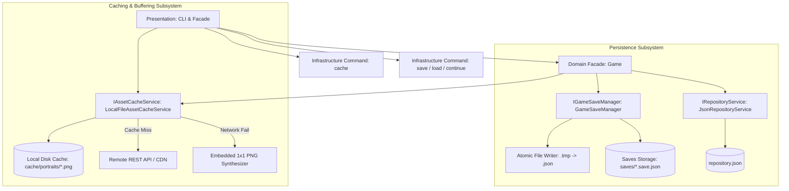
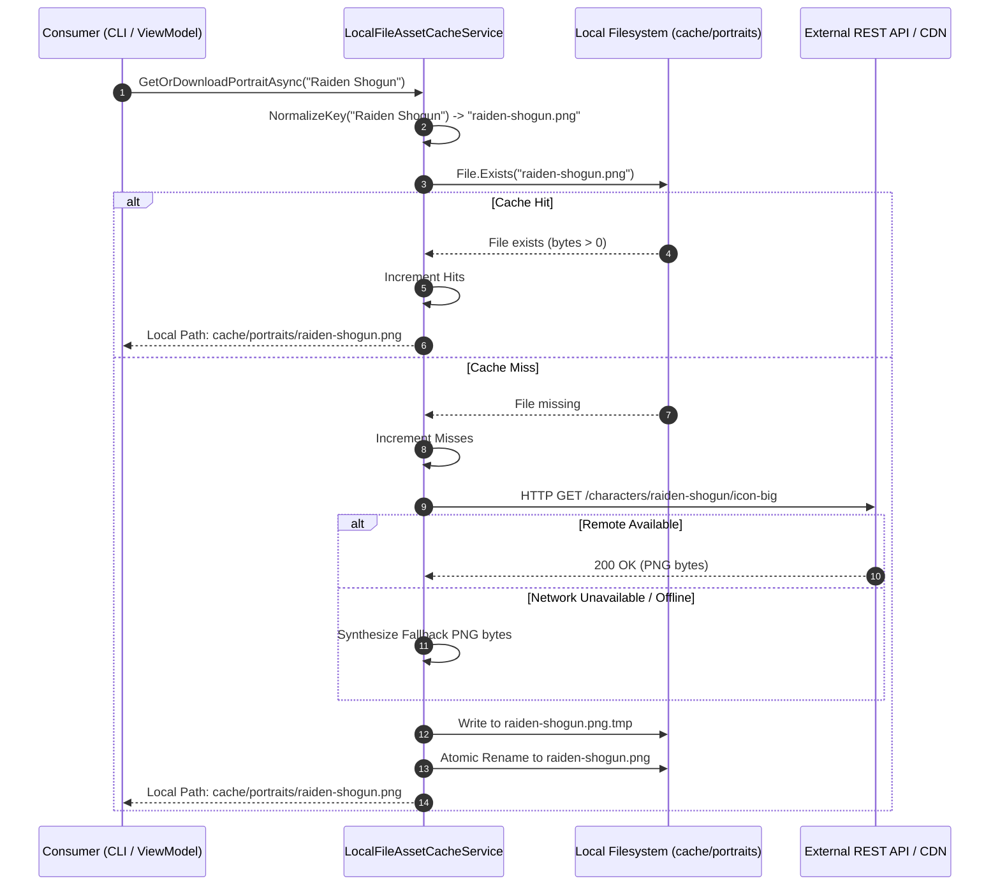
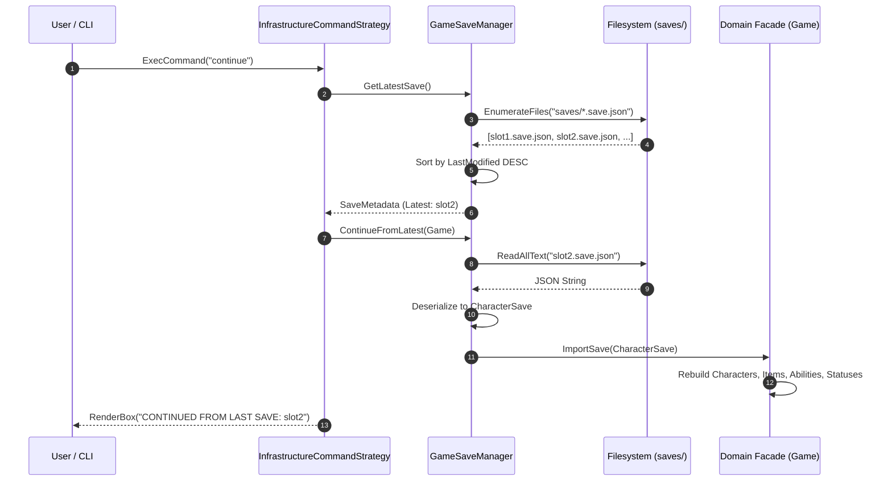
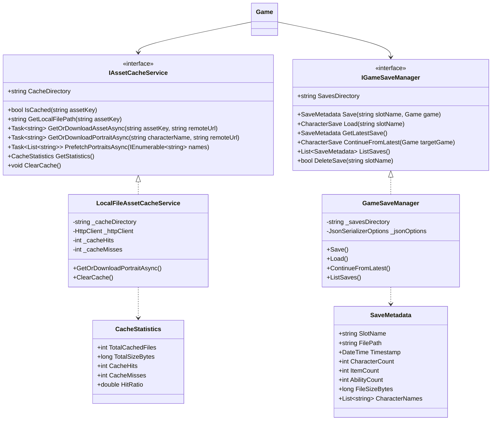

# Software Design Document (SDD)
## Subsystem: Persistence, Asset Buffering & State Continuation

**Project Name:** Modular Application Platform & RPG Character Engine  
**Module:** Infrastructure & Persistence Layer (Practical Work 15)  
**Architecture Style:** Clean Architecture (Repository Pattern, Cache-Aside, Atomic File I/O, Memento/Snapshot)  
**Language & Platform:** C# 12, .NET 8.0, xUnit  
**Status:** Approved & Finalized  

---

## 1. Executive Summary & Purpose

The purpose of this document is to specify the architectural design, serialization protocols, and component interactions of the **Persistence & Caching Subsystem** for the RPG platform and Character Catalog.

In enterprise software engineering, preserving state and optimizing network interactions are foundational requirements:
1. **Minimizing Network Bandwidth & Latency (Buffering/Caching):** Frequent REST requests for media assets (character portraits) saturate bandwidth and degrade user experience. A deterministic local disk buffer using the **Cache-Aside pattern** guarantees immediate access to graphics and offline availability.
2. **State Persistence & Fault-Tolerant Continuation:** User progress, created characters, inventory items, and dynamic combat states are held in volatile RAM during execution. By leveraging structured JSON serialization with **atomic write operations** and a dedicated slot manager, the application guarantees that progress survives process restarts and allows seamless resumption from the latest save point.

---

## 2. High-Level Architectural Context

### Architectural Principles
- **Separation of Concerns:** Business logic (`Character`, `TurnBasedBattleEngine`) remains completely agnostic of disk layout, serialization format, and network clients.
- **Cache-Aside Pattern:** Consumers query the cache service. If cached, the local disk file is returned immediately; if missed, the file is downloaded, persisted atomically, and returned.
- **Atomic I/O Resilience:** Writes stage data to unique temporary files (`.tmp`) before renaming, eliminating file truncation or corrupt JSON states on unexpected power cuts or crashes.
- **Single Source of Truth for Continuation:** Save snapshots include UTC timestamps and checksum metadata. The save manager determines the latest save point dynamically.

---

## 3. Character Catalog Asset Buffering (Cache-Aside)

### 3.1. Design & Protocol
The asset caching engine (`LocalFileAssetCacheService`) implements `IAssetCacheService`:
- **Cache Key Normalization:** Sanitizes arbitrary character names into URL/filesystem-safe slugs (e.g., `"Raiden Shogun"` $\to$ `"raiden-shogun.png"`).
- **Lookup Protocol:**
  1. Inspects `cache/portraits/{slug}.png`.
  2. If file exists and size $> 0$: **Cache Hit** $\to$ increments hits counter, returns local path.
  3. If missing: **Cache Miss** $\to$ issues HTTP GET request to CDN/API.
  4. On HTTP success: writes response byte array to `.tmp`, atomically renames to target path, increments misses counter.
  5. On HTTP error/offline: falls back to an embedded 67-byte valid PNG byte array, persists locally, and returns valid path.

### 3.2. Telemetry & Metrics
The cache collects real-time diagnostics accessible via `CacheStatistics`:
$$\text{Total Requests} = \text{Hits} + \text{Misses}$$
$$\text{Hit Ratio} = \frac{\text{Hits}}{\text{Total Requests}}$$
Metrics include file counts, total disk bytes, hit ratio %, and directory paths.

---

## 4. Game State Persistence & Continuation

### 4.1. Save Slot Serialization Model
Save files are stored as independent, human-readable JSON files in `saves/{slotName}.save.json`.
Each save file encapsulates:
- `SaveName`: Identifies the slot name.
- `LastModified`: UTC ISO-8601 timestamp for ordering and continuation.
- `Characters`: List of characters, health, power, armor, speed, resistance, and active `StatusEffects`.
- `Items`: Equipped gear with `HpMod`, `PowerMod`, `ArmorMod`, and `SpeedMod`.
- `Abilities`: Learned abilities, magic flags, resistance penetration, and scaling factors.
- `CharacterItems` & `CharacterAbilities`: Relational join tables.

### 4.2. "Continue from Last Save" Protocol
The `continue` command enables seamless session resumption without specifying slot names:
1. `GameSaveManager.GetLatestSave()` enumerates `saves/*.save.json`.
2. For each file, the header and timestamp are evaluated.
3. The entry with the highest `Timestamp` (or newest file write time) is identified.
4. If found, `ContinueFromLatest(game)` deserializes the file, wipes current memory state, rebuilds domain aggregates, and informs the user.
5. If no saves exist, a graceful notification is rendered.

---

## 5. Class Diagrams & Component Contracts

---

## 6. Storage Locations & System Conventions

As highlighted in the theoretical syllabus:
- **Project-Level Portability:** Defaults to local workspace folders (`cache/portraits/` and `saves/`), allowing self-contained test execution, versioning, and zero permission issues across Windows and Linux.
- **Operating System Standards:** Can be configured to redirect to:
  - Windows: `%LOCALAPPDATA%\ModularRpgPlatform\cache` and `saves`
  - Linux / macOS: `~/.local/share/ModularRpgPlatform/` or `~/.cache/`
- **Clean Hygiene:** No scattered files in user root directories.

---

## 7. Verification & Testing Strategy

The persistence and buffering system is validated via 10 comprehensive xUnit tests in `Tests/PersistenceTests.cs`:
1. `AssetCache_CacheMiss_DownloadsAndSavesFileLocally`: Verifies HTTP fetch and file persistence on cache miss.
2. `AssetCache_CacheHit_DoesNotMakeNetworkRequest`: Verifies zero HTTP calls when asset exists on disk.
3. `AssetCache_OfflineFallback_GeneratesLocalAssetWhenNetworkFails`: Verifies valid PNG synthesis during network outages.
4. `AssetCache_Prefetch_BuffersMultiplePortraits`: Validates concurrent batch caching.
5. `AssetCache_ClearCache_DeletesFilesAndResetsCounters`: Validates disk cleanup and metric reset.
6. `GameSaveManager_SaveAndLoad_RestoresFullGameState`: Asserts full restoration of characters, items, abilities, dynamic stats, and status effects.
7. `GameSaveManager_ContinueFromLatest_RestoresMostRecentSave`: Creates multiple chronological saves and ensures `continue` selects the newest.
8. `GameSaveManager_ContinueFromLatest_ThrowsWhenNoSavesExist`: Ensures graceful error handling.
9. `GameSaveManager_ListSaves_ReturnsSortedByTimestampDescending`: Verifies descending timestamp order.
10. `Cli_SaveAndContinue_ResumesGameSessionSeamlessly`: End-to-end command-line workflow validation.

---

## 8. Conclusion

Practical Work 15 fulfills all functional and architectural requirements:
- High-efficiency asset buffering (Cache-Aside pattern) preventing redundant network calls.
- Atomic file-based state saving with full support for user-created characters.
- Instant, fault-tolerant game resumption via the `continue` command.
- Complete architectural documentation and automated test verification.
